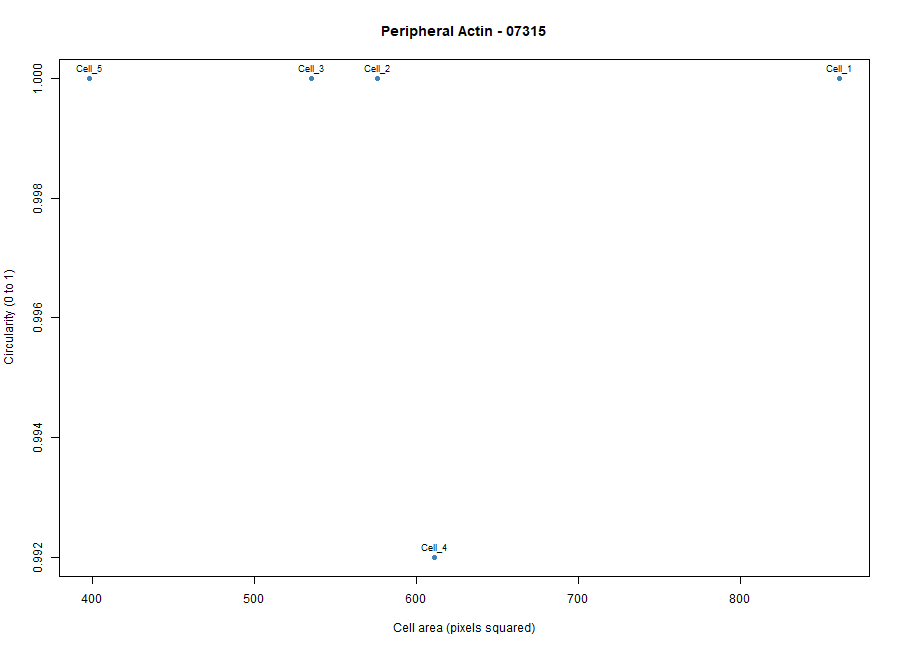
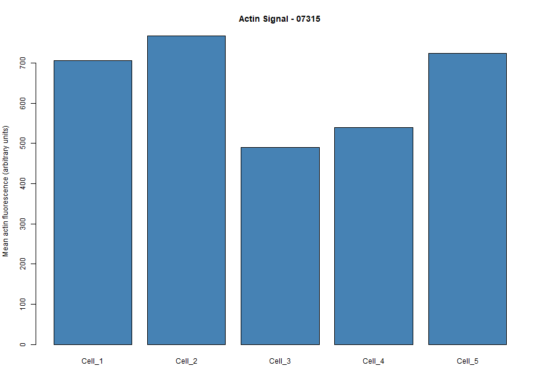

# Cytoskeleton and Cell Morphology

## 1. Student Information

- **Student ID:** 202303461
- **Chosen Phenotype:** Peripheral Actin
- **Image-Field ID:** 07315
- **Dataset:** BBBC018v1

## 2. Selected Image

- **Actin Image:** `07315-actin.DIB`
- **DNA Image:** `07315-DNA.DIB`
- **Image-Field ID:** 07315

The selected phenotype was determined through visual assessment of the fluorescence microscopy image. The actin fluorescence pattern appeared concentrated around the cell periphery, supporting the tentative classification as Peripheral Actin.

## 3. Objective

To examine the morphology and actin fluorescence intensity of five selected cells from a BBBC018 fluorescence microscopy image classified as Peripheral Actin.

## 4. Methodology

1. Downloaded and extracted the BBBC018v1 image dataset.
2. Opened the matching actin and DNA images (`07315-actin.DIB` and `07315-DNA.DIB`) using Fiji/ImageJ.
3. Visually examined the image and selected five intact, clearly outlined cells.
4. Measured the cell area, mean gray value, circularity, aspect ratio, roundness, and solidity using Fiji/ImageJ.
5. Exported the measurements as a CSV file.
6. Imported the measurements into R for descriptive analysis and visualization.
7. Generated two figures: cell area versus circularity and mean actin fluorescence intensity.

## 5. Results

A total of **5 cells** were measured.

| Parameter | Mean Value |
|---|---:|
| Cell area | 596.2 |
| Mean actin fluorescence intensity | 645.6502 |
| Circularity | 0.9984 |
| Aspect ratio | 1.0518 |

**Note:** Cell area is expressed in pixels squared. Mean actin fluorescence intensity is expressed in arbitrary gray-value units.

### Figures

**Figure 1. Cell Area versus Circularity**

This figure shows the relationship between the measured cell areas and circularity values of the five selected cells.

**Figure 2. Mean Actin Fluorescence Intensity**

This figure presents the mean actin fluorescence intensity of each selected cell.

## 6. Explanation of Results

### 1. Which specific phenotype did you choose, and what visible features support that choice?

I chose the Peripheral Actin phenotype based on my visual assessment of image 07315. The actin fluorescence appeared concentrated around the cell periphery, supporting my classification.

### 2. Were your five cells mostly round or elongated?

The five measured cells were mostly round, as indicated by the mean circularity of 0.9984 and mean aspect ratio of 1.0518.

### 3. What role does actin play in maintaining cell shape and in cell movement?

Actin filaments help maintain cell shape by supporting the cell cortex. They also contribute to cell movement through cytoskeletal remodeling and interactions with myosin.

### 4. Why can a single fixed fluorescence image NOT show how fast a cell moves?

A single fixed fluorescence image captures cells at only one point in time. It cannot show changes in cell position over time, which are needed to determine movement speed.

## 7. Files Included

- `data/Fiji_results.csv` — Fiji cell measurements used for analysis
- `scripts/analyze_cells.R` — R analysis script
- `results/cell_summary.csv` — Numerical summary of the measurements
- `figures/area_vs_circularity.png` — Cell area versus circularity plot
- `figures/actin_intensity.png` — Mean actin fluorescence intensity plot

## 8. Limitations

This analysis was based on five selected cells from a single image field. The findings are descriptive and may not represent all cells in the image or the entire phenotype population.

The phenotype classification is based on visual assessment and is not a verified annotation. A single fixed image also cannot establish cell movement or speed.

## 9. References

- [BBBC018 Dataset](https://bbbc.broadinstitute.org/BBBC018)
- [BBBC018 Direct Download](https://data.broadinstitute.org/bbbc/BBBC018/BBBC018_v1_images.zip)
- [Fiji (ImageJ)](https://fiji.sc/)
